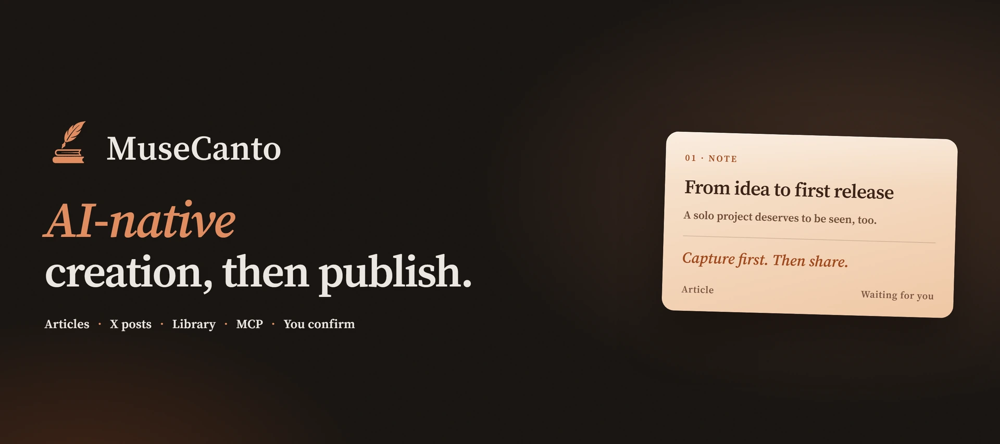

  

  🌐&nbsp;<b><a href="https://musecanto.com">musecanto.com</a></b>
  &nbsp;|&nbsp;
  ⬇️&nbsp;<a href="https://musecanto.com/download">Download</a>
  &nbsp;|&nbsp;
  📖&nbsp;<a href="https://musecanto.com/docs">Docs</a>
  &nbsp;|&nbsp;
  🧩&nbsp;<a href="https://chromewebstore.google.com/detail/ggeemkffcdbihflhekbfdlfpegimgkle">Extension</a>

  

MuseCanto is a creation and publishing workspace for the AI you already use. Connect ChatGPT, Claude, Grok, Cursor, Codex, or any agent, and write in the conversation. The original stays in your library. Long-form articles are filled into platform editors by the browser extension. X posts can be scheduled and sent from the cloud. Nothing goes out until you confirm.

## Product

| | About |
| --- | --- |
| [musecanto.com](https://musecanto.com) | Creation and publishing workspace |
| [Docs](https://musecanto.com/docs) | MCP, the browser extension, and publishing |
| [Download](https://musecanto.com/download) | Web app and Chrome extension |
| [Changelog](https://musecanto.com/changelog) | Product updates |
